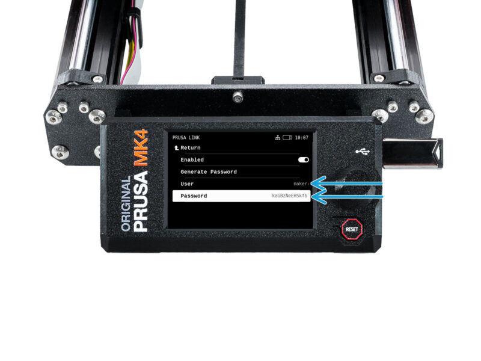
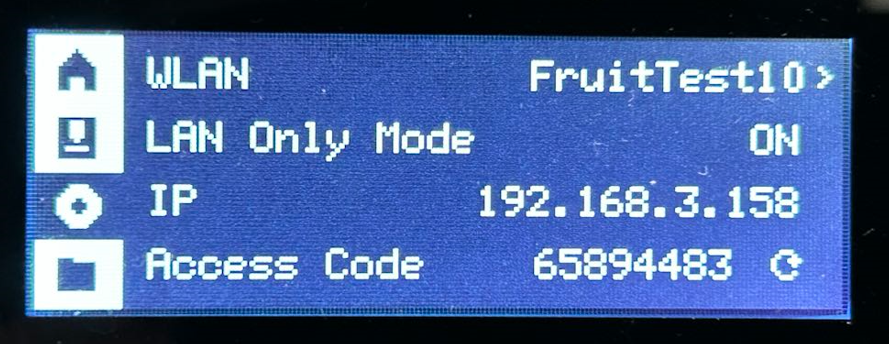
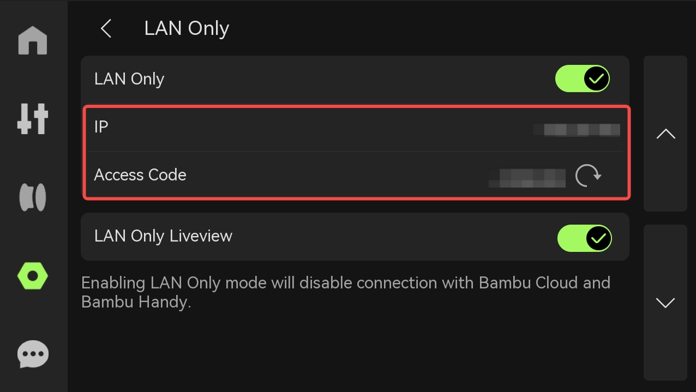

# Connect Your Computer to the Printers

The information on this page is intended for inducted HacMan members who want to set up their own computer to connect to the printers. Your computer must be connected to the Hackspace Wi-Fi or wired network.

The codes below are examples and may have changed. If a code does not work, follow the steps below to find the current one on the printer, then enter it on your computer. Please leave the printer's code unchanged.

/// warning | Read the code — please do not change it
These are shared printers. Changing a code disconnects other members and the workshop computers. **Do not press the circular refresh arrow beside a Bambu access code, or select Generate Password on a Prusa.** Reading the displayed value is enough. Leave LAN mode, Wi-Fi, PrusaLink and account settings as they are; do not reset a printer or bind it to a personal account to fix a login problem. If a setting needs changing, ask the 3D printing team.
///

Jump to [Prusa MK4: Kim and Romanov](#prusa-mk4-printers), [Bambu P1S: Delilah](#bambu-p1s), or [Bambu P2S: Artemis and Constantine](#bambu-p2s-printers).

## Prusa MK4 printers

| Printer | IP address | Example PrusaLink key (may be out of date) |
|---|---|---|
| Kim | `172.16.0.123` | `dmAPJnhhJ37VXBV` |
| Romanov | `172.16.0.124` | `xptZZwt7MdVHufn` |

### Find the current PrusaLink key

Use the rotary knob to highlight menu entries and press it to open them.

1. Check the printer's name: **Kim** or **Romanov**. Each has its own key.
2. On that printer, open **Settings > Network**. Read **IPv4 Address** if you need to check its IP address.
3. Open **PrusaLink** within the Network menu.
4. Read **User** and **Password**. The password is also the **PrusaLink API key** used by PrusaSlicer. Copy it exactly, including upper- and lower-case letters.
5. Return to your computer and use that key in the matching physical-printer connection, or use the displayed username and password in your browser.

**Leave Generate Password alone.** It creates a different password; it is not needed to reveal or copy the existing one. If PrusaLink is disabled or the menu looks unfamiliar, ask the team instead of changing the settings.

<figure markdown="1">
  
  <figcaption>The blue arrows point to User and Password. Read those two values; leave Generate Password alone. Image: <a href="https://help.prusa3d.com/guide/sending-files-from-prusaslicer-to-prusalink_222961#417427">Prusa Research</a>. The pictured password is an example, not a HacMan key.</figcaption>
</figure>

### Add a physical printer to PrusaSlicer

1. Connect the computer to the Hackspace network.
2. Open PrusaSlicer and install the Original Prusa MK4 0.4 mm preset if it is not already present.
3. Open the physical-printer configuration and add the intended printer.
4. Set the host type to **PrusaLink**. Enter the printer's name and IP address, then paste the key read from its screen into **API Key / Password**.
5. Save it as a physical printer.
6. Slice with that physical printer selected, check Preview, then use the bottom-right **G** button to send the file.

If sending fails, first check that a physical printer—not the generic MK4 preset—is selected.

### Use PrusaLink in a browser

It is acceptable to use the Prusa MK4 printers with a different slicer or correctly prepared custom G-code, provided the file is suitable for the selected printer, nozzle and filament.

Visit the printer's IP address from a device connected to the Hackspace network. Use:

- username: the **User** shown on the printer's PrusaLink screen (normally `maker`)
- password: the **Password** shown on that same screen, also called the PrusaLink key

This can be used to upload correctly prepared G-code without configuring PrusaSlicer. Confirm that the file was sliced for the correct MK4 and nozzle before uploading it.

## Bambu P1S

| Name | IP address | Example access code (may be out of date) |
|---|---|---|
| Delilah | `172.16.0.201` | `21848185` |

### Find Delilah's current access code

1. At **Delilah**, use the arrow buttons and **OK** to open **Settings** (the gear icon).
2. Open **WLAN** — on the HacMan printer this may show **WLAN: Hackspace**.
3. Read the **Access Code** and **IP** on this screen. Copy the code exactly.
4. Use these values to [connect Bambu Studio](#connect-bambu-studio).

**Do not select the circular refresh arrow at the right of Access Code.** It generates a new code and breaks existing connections. Leave **LAN Only Mode** as you find it; if it is off or the code is missing, ask the team.

<figure markdown="1">
  
  <figcaption>Read Access Code on the bottom row. Leave the circular arrow beside it alone. Image: <a href="https://wiki.bambulab.com/en/knowledge-sharing/enable-lan-mode#p1pp1s-series-printers">Bambu Lab's P1P/P1S guide</a>; the network, address and code pictured are manufacturer examples.</figcaption>
</figure>

## Bambu P2S printers

| Printer | IP address | Example access code (may be out of date) |
|---|---|---|
| Artemis | `172.16.0.15` | `265f2109` |
| Constantine | `172.16.0.115` | `7cf07571` |

### Find Artemis or Constantine's current access code

1. Check the printer's name: **Artemis** or **Constantine**. Read the code from the machine you want to use.
2. On its touchscreen, open **Settings** in the left sidebar, then the **Settings** tile, then **LAN Only**.
3. Read **Access Code** and **IP** on the LAN Only page. Copy the code exactly, including any letters.
4. Use these values to [connect Bambu Studio](#connect-bambu-studio).

**Do not tap the circular refresh arrow next to Access Code.** Do not toggle **LAN Only**, **LAN Only Liveview** or **Developer Mode** while looking for the code. If the page or code is unavailable, ask the team rather than changing modes.

<figure markdown="1">
  
  <figcaption>The red box surrounds IP and Access Code. Read the code beside Access Code; do not tap the circular arrow to its right. Image: <a href="https://wiki.bambulab.com/en/knowledge-sharing/enable-lan-mode#connect-to-the-printer-using-the-access-code-and-ip">Bambu Lab's LAN connection guide</a>. Its example values are blurred. Layout and wording can vary with firmware.</figcaption>
</figure>

## Connect Bambu Studio

These steps apply to Delilah, Artemis and Constantine.

1. Connect your computer to the Hackspace Wi-Fi or wired network.
2. Open **Device** in Bambu Studio and open the printer list.
3. Select the intended LAN printer (shown with a lock icon) and enter the code read from its screen. Discovery can take a minute.
4. If it is not listed, choose **Bind with access code** and enter its IP address and current code. Use the LAN access code, not an account-binding PIN.
5. Confirm the printer's name and check its camera feed where available, then synchronise the printer, nozzle, build-plate and AMS filament information.

If an old saved code is rejected, enter the one now displayed on that printer. **Change the connection on your computer, not the code on the printer.** The camera is available only from within the Hackspace network, including Hackspace Wi-Fi.

## If you still cannot connect

Check that you are on the Hackspace network, using the right printer and copying its displayed value exactly. The screenshots and tables contain examples; the printer's own screen takes precedence. Menu wording may differ after firmware updates.

If that does not resolve it, contact the 3D printing team on Telegram, post on the HacMan forum, or submit a broken-tool report using one of the QR codes around the Hackspace. Include the printer's name and what failed. If you accidentally changed a code, tell the team so they can restore the workshop computers' connections. Do not post the new code publicly on Telegram or the forum.

Routine code changes do not require a documentation update: members can read the current value themselves. Please report changed IP addresses, different menu paths or instructions that no longer work so this guide can be corrected.

## Manufacturer references

- [Bambu Lab: LAN mode and finding the access code (P1P/P1S and H2/P2S/X series)](https://wiki.bambulab.com/en/knowledge-sharing/enable-lan-mode)
- [Bambu Lab: P2S screen operation guide](https://wiki.bambulab.com/en/p2s/manual/screen-operation)
- [Bambu Lab P2S user manual, section 7.3.1, page 68](https://csm.bblcdn.com/hub/9425242c00344b0e801b6179f9a243aa.pdf#page=69)
- [Prusa: credentials on the MK4/XL printer](https://help.prusa3d.com/guide/sending-files-from-prusaslicer-to-prusalink_222961#417427)

The manufacturer guides also describe initial setup. HacMan printers are already configured: follow the read-only lookup steps above and leave setup, code generation and network changes to maintainers. Manufacturer references checked 30 October 2026.
