Filter Cleaner
==============

|              | Filter Cleaner                                   |
|--------------|--------------------------------------------------|
| Model No.    | Member-built (ESP32-S3 and a car wiper motor)    |
| Asset ID     |                                                  |
| Location     | Woodwork, on the dust extractor                  |
| Status       | Being commissioned                               |
| Ownership    | Hackspace                                        |
| Training     | None needed                                      |
| Lone Working | Allowed                                          |
| Materials    | n/a                                              |

What it does
------------

The filter cleaner keeps the dust extractor's filter clear. A motor turns the filter's cleaning mechanism, which knocks the dust off the filter and into the dust bin.

-	When the extraction has run for at least a minute and someone switches it off, the cleaner waits **1 minute**, then turns the cleaning mechanism **5 times**. That's a clean.
-	It **never** runs while the extraction is on. If the extraction comes back on during the wait or the clean, it stops straight away and cleans after that session instead.
-	It won't clean into a full dust bin, or with the bin out.
-	The extraction always works as normal. The cleaner never stops you using it.

Normally you don't need to do anything at all.

/// warning | Keep hands clear of the cleaning motor
The motor starts by itself a minute after the extraction is switched off. While the screen says **CLEANING IN...** or **CLEANING**, keep your hands away from the motor and its linkage. Press **STOP** to cancel.
///

The buttons
-----------

| Button          | What it does                                                                                                   |
|-----------------|----------------------------------------------------------------------------------------------------------------|
| **START** (green) | Clean now, when a clean is due. **RETRY** after a jam. It's greyed out on the screen when it has no job.       |
| **STOP** (red)    | Cancel the wait or a clean. Silence the dust bin alarm for 15 minutes.                                       |

The screen shows what each button does right now, next to the button.

Everyday screens
----------------

### Ready

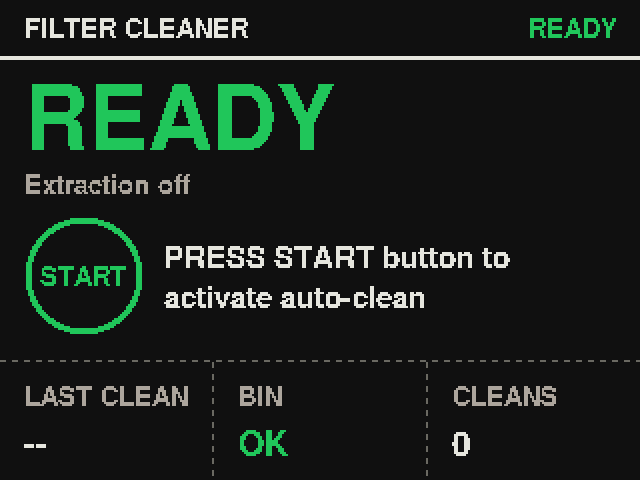{ width="320" }

Nothing to do. Along the bottom: how long since the last clean, the dust bin (**OK**, **FULL** or **OUT**), and the number of cleans since the filter was last changed. After a while the screen goes dark to save it. Press any button to wake it.

### Extraction running

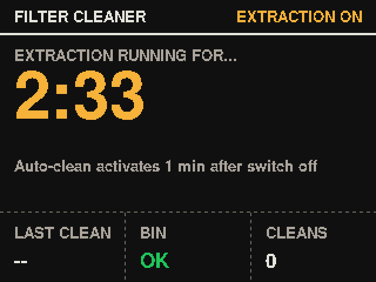{ width="320" }

It has seen the extraction come on and is timing the session. Pressing START now just shows **EXTRACTION RUNNING**: it can't clean until the extraction is off.

### Cleaning in...

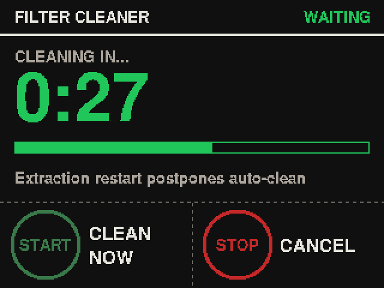{ width="320" }

The extraction's off and a clean starts when the countdown runs out. **CLEAN NOW** (START) cleans straight away, once the fan has had 30 seconds to stop. **CANCEL** (STOP) stops this clean.

### Cleaning

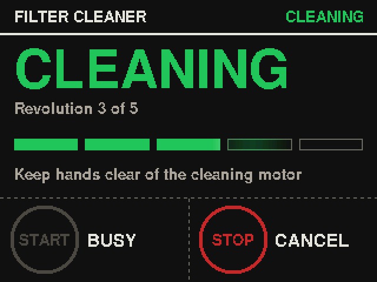{ width="320" }

The motor's cleaning the filter. Each bar is one turn, and a light sweeps along them so you can see it's working. It only takes a few seconds. **CANCEL** (STOP) stops the motor at once.

The dust bin
------------

### Dust bin full {#bin-full}

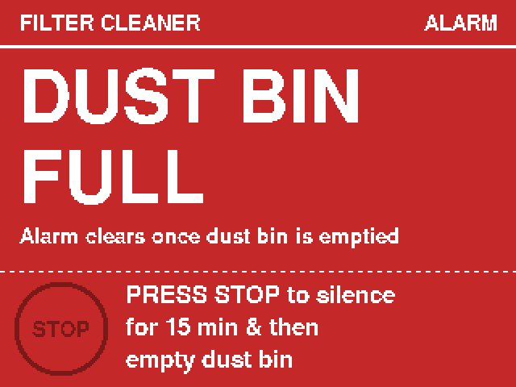{ width="320" }

The screen turns red and the buzzer beeps every few seconds.

1.	Switch the extraction **off**.
2.	Unscrew the dust bin from under the filter and empty it.
3.	Screw it back on until the two lines line up. The screen should show **BIN OK**.
4.	If the screen then says **Clean due: PRESS START**, press **START**.

Busy and can't do it now? **STOP** silences the alarm for 15 minutes. Please tell someone or post in the [Woodwork chat](https://t.me/HACManchester/200505) if you leave it. Cleans wait until the bin's emptied, so the filter clogs if it's left.

### Dust bin missing {#no-bin}

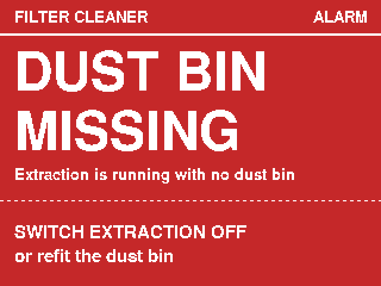{ width="320" }

The extraction is running with the bin out, so the dust is going on the floor. The screen flashes, the buzzer beeps non-stop, and STOP won't silence it. **Switch the extraction off, or screw the bin back on.** That's all it takes to stop it.

### Bin out, clean held and clean due {#bin-out}

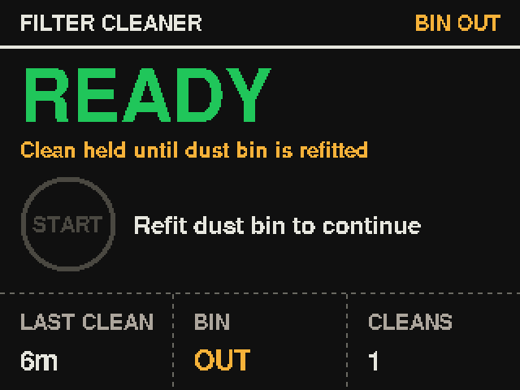{ width="240" }
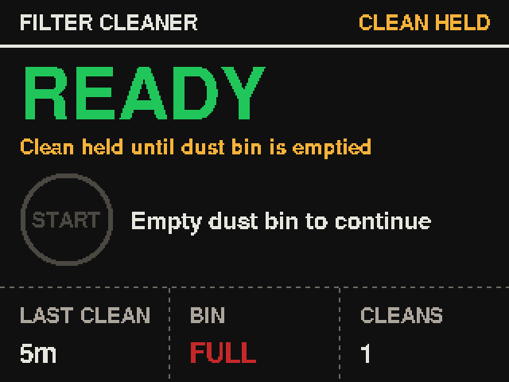{ width="240" }
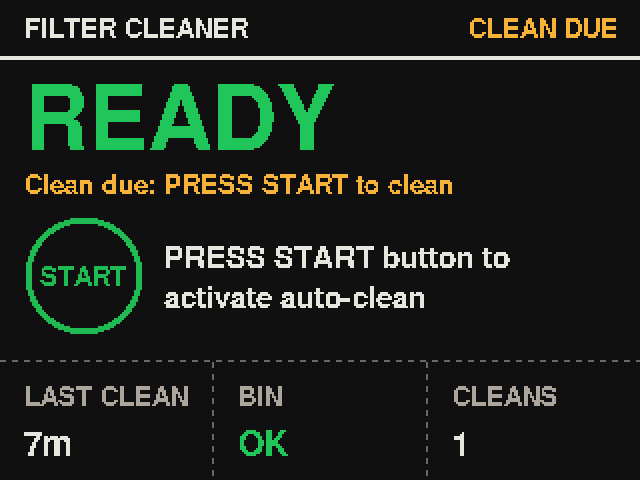{ width="240" }

-	**BIN OUT**: screw the dust bin back on, with the two lines lined up.
-	**CLEAN HELD**: a clean was due, but the bin was full or out, so it waited. Empty the bin, or screw it back on.
-	**CLEAN DUE: PRESS START**: the bin's back and empty. Press **START** to do the clean that was waiting. (If nobody does, it happens after the next time the extraction is used.)

If something's wrong
--------------------

The three fault screens have a QR code. Scan it with your phone camera and it opens the right part of this page.

If a fault has been showing for an hour, the cleaner sends an alert to whoever looks after it, and another when it clears. If you can't sort it, please still post in the [Woodwork chat](https://t.me/HACManchester/200505) so others know.

### Motor jammed {#jam}

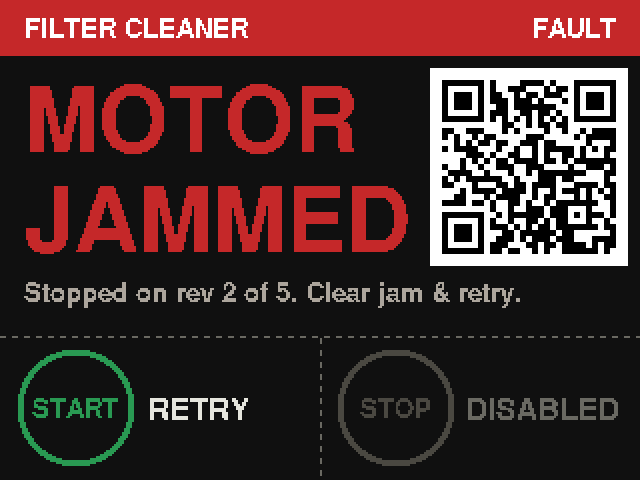{ width="320" }

The motor didn't get round in time, so it switched itself off. Automatic cleans are paused until someone presses **RETRY**.

1.	Make sure the extraction is **off**.
2.	Switch the filter cleaner off at its power switch or plug before you reach in.
3.	Look at the motor's linkage for whatever's stopping it: an offcut, a loose fixing, or something caught in it. Clear it.
4.	Switch the cleaner back on, stand clear, and press **START**. It should do a full clean. (If you cleared it without switching off, **START** is **RETRY**.)

If it jams again straight away, leave it switched off and post in the [Woodwork chat](https://t.me/HACManchester/200505). Don't try to force it round by hand.

### STOP button {#stop}

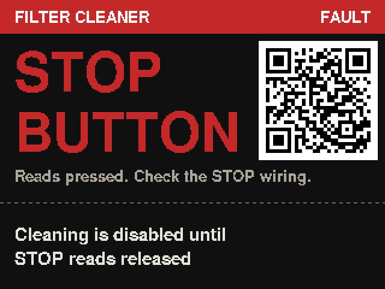{ width="320" }

The STOP button has read "pressed" for 15 seconds. Either something's leaning on it, or a wire behind it has come off. For safety, it won't clean until STOP reads released again.

-	If something's pressing it, move it. The fault clears by itself.
-	If nothing is, it's a wiring fault. Post in the [Woodwork chat](https://t.me/HACManchester/200505). The extraction still works as normal.

### Clamp lead {#clamp}

{ width="320" }

The cleaner knows the extraction is on from a current clamp round one of the extractor's power cores. Its reading has gone out of range, usually because a lead has worked loose. Without it the cleaner can't tell whether the extraction is on, so it won't clean until it reads properly again. The fault clears by itself once it does.

Please don't open the extractor's wiring to look. Post in the [Woodwork chat](https://t.me/HACManchester/200505). The extraction still works as normal.

### It restarted by itself {#restarts}

It comes back on the Ready screen and carries on as normal. A one-off is nothing to worry about. If it was part way through a clean, it may say **Clean due: PRESS START**: press **START**. If it keeps happening, the person who looks after it gets an alert, and the black box (below) records why.

### Updating firmware

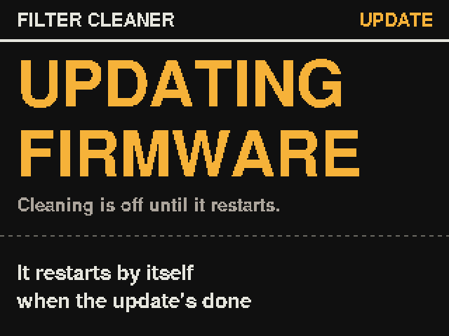{ width="320" }

New firmware is being loaded over the Wi-Fi. The motor's off and cleans wait. It restarts by itself in a minute or so.

For whoever looks after it
--------------------------

### Info screen

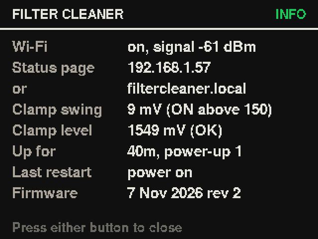{ width="320" }

On the **Ready** screen, hold **STOP** for 3 seconds and let go. The info screen shows whether it's on the Wi-Fi, the address of the status page, the clamp readings (live), how long it's been up, why it last restarted, and the firmware it's running. It closes after a minute, or when you press either button.

**Setting the clamp threshold:** watch **Clamp swing** with the extraction off, then on. **Extraction counts as ON above** on the admin page wants to sit well between the two (the swing turns amber when it's above the threshold). **Clamp level** should say OK; FAULT means a lead's loose.

### Status page

On the Hackspace Wi-Fi, open **http://filtercleaner.local/**, or the IP address on the info screen (it's also in the "online" alert it sends each time it starts). It shows what the screen is showing, the extraction and clamp readings, the bin, clean counts, how long it's been up, why it last restarted, the Wi-Fi signal, and the black box. It refreshes every 10 seconds. It can only show things: nothing on it can start the motor. There's also **/status.json** for anything that wants to read it, and a link to the admin page.

**/log** (linked at the bottom of the status page) is everything it has done recently, with times: extraction on and off, countdowns, each revolution of every clean with how long it took, faults, alerts and the Wi-Fi. It's in memory, so a restart clears it; the black box is kept.

### Admin page

For whoever looks after the cleaner. Open **http://filtercleaner.local/admin** and log in with the admin password (ask the woodwork team). It has:

-	**Every setting.** The ones worth tuning can be changed there and then: the clamp threshold, the wait after switch-off, turns per clean, the jam timings, the bin alarm silence, alert delays, screen brightness and more. They're kept through power cuts and updates. Each has limits, so a typo can't stop it working, and **Back to defaults** puts them all back. The rest are shown, with a note that they need a change in the sketch.
-	**Every count, each with its own reset:** cleans since the filter was changed, lifetime cleans, motor starts and running time, jams, extraction sessions and running time, power-ups and alerts.
-	**Clean now, Stop, Filter changed and Restart.** Clean now counts down 15 seconds with a beep first, so anyone at the machine knows, and **STOP** on the unit cancels it. It still won't clean with the extraction on, the bin out or full, a clamp fault, or STOP held, and it can't retry a jam: someone has to clear that at the machine.
-	**The black box and the log**, with buttons to clear them, and **firmware updates** (see below).

Settings can't be changed while it's cleaning or counting down. Every change from the admin page goes in the black box. The password never crosses the Wi-Fi, and every request is signed, so nothing seen on the network can be reused. Five wrong passwords in a row lock the login for 5 minutes and send an alert. It logs you out after 30 minutes unused.

If you change the wait after switch-off, the silence time or the turns per clean, the unit's own screens follow, but the laminate and this page quote the defaults.

### Alerts

When a fault has been showing for an hour (10 minutes for the no-bin alarm), the cleaner sends one alert, with what to do and a link to this page, and another when it clears. It also sends one if it restarts after a freeze, a crash or the power dipping (the 1st, 5th, 20th and every 100th in a row, so it can't flood your phone), and if an update has to be undone (see below).

Each time it starts up and joins the Wi-Fi, it also sends a silent **online** note with its address and the firmware it's running, so after an update you can see it took. That one only goes to ntfy, not Telegram.

Alerts go by [ntfy](https://ntfy.sh): install the ntfy app and subscribe to the cleaner's topic, which is in `Secrets.h` (ask the woodwork team for it; it isn't published, as anyone with it can read the alerts). They can also go to a Telegram group or topic through a bot, if a bot token and chat ID are set in `Secrets.h`.

If the Wi-Fi is down, alerts wait and go when it's back. The cleaner itself works exactly the same with no Wi-Fi at all.

### Black box

The last 32 faults and restarts, kept through power cuts, with the date and time (or, before the Wi-Fi has set its clock, which power-up and how long after it), plus anything done from the admin page. It's on the status page. A restart while the motor was running is flagged: that points at the motor dragging the 12V supply down.

### New filter fitted

On the **Ready** screen, hold **STOP**, then also hold **START**, and keep both held for 5 seconds. The screen says **FILTER CHANGED** and the clean count goes back to 0. The lifetime count is kept. (**Filter changed** on the admin page does the same.)

### Testing after a repair

Switch the filter cleaner off and on again, then press **START**. After a power-up it always allows one clean, even if the filter was already clean. Stand clear. The log shows how long each revolution took, which is the first thing to look at when chasing jams.

### Updating the firmware

The sketch is in the `FilterCleaner` folder: `FilterCleaner.ino` plus `Types.h`, `HelveticaBold.h`, `QrGuide.h`, `Net.h`, `Admin.h`, `AdminPage.h`, `Sha256.h` and `Secrets.h`. Libraries: Adafruit GFX Library and Adafruit ST7735 and ST7789 Library.

Board settings: **ESP32S3 Dev Module**, **USB CDC On Boot: Enabled**, **Partition Scheme: Minimal SPIFFS (1.9MB APP with OTA/128KB SPIFFS)**. The clean counts and black box survive an upload.

Updates go over the Wi-Fi. (The very first upload, which sets the partition scheme and puts the Wi-Fi details on, has to be by USB.) With `OTA_PASSWORD` set in `Secrets.h`:

-	From the Arduino IDE: pick the network port called **filtercleaner**.
-	From the admin page: Sketch > Export Compiled Binary, then on **http://filtercleaner.local/admin**, under Firmware, pick `FilterCleaner.ino.bin` (not the bootloader, partitions or merged one). The page checks it's firmware for this chip before sending it, and the cleaner checks it arrived exactly as sent before it uses it. The admin password is `ADMIN_PASSWORD` in `Secrets.h`, or `OTA_PASSWORD` if there isn't one.

While an update comes in, the motor's off, cleans wait and the screen says **UPDATING FIRMWARE**. Then it restarts and sends its **online** note with the new firmware's name.

**A bad update undoes itself.** New firmware starts on probation. If it crashes, freezes or restarts before it has joined the Wi-Fi (or run for 15 minutes, if the Wi-Fi's down), the cleaner goes back to the firmware it had before by itself, notes it in the black box and sends an alert. If an update stops part way, it keeps the old firmware and carries on. Even so, try new firmware on the bench first: an update that runs but can't join the Wi-Fi, and stays up for 15 minutes, is kept, and then it's back to USB.

### How it keeps itself out of trouble

-	**It never runs with the extraction on.** If the clamp reading can't be trusted, it doesn't clean at all.
-	**STOP is wired fail-safe.** A broken wire reads as STOP held, which stops the motor.
-	**A watchdog** restarts it if the program ever freezes, with the motor off.
-	**The Wi-Fi runs on the chip's other core**, so it can never hold up the buttons, motor or safety checks. If the network side hangs, the board restarts with the motor off; if it keeps hanging, it carries on without the network rather than keep restarting.
-	**Self-healing screen:** the screen's settings are re-sent every minute, and a screen that's been up 10 minutes is repainted, so a burst of electrical noise can't leave it scrambled.

Safety
------

-	Keep hands clear of the cleaning motor and linkage while the screen says **CLEANING IN...** or **CLEANING**.
-	Switch the filter cleaner off before clearing a jam or reaching into the linkage.
-	Switch the extraction off before unscrewing the dust bin.
-	The usual dust extraction rules apply: see [Dust Extraction](../training/dust_extraction.md).
